  

  
  
  
  
  
  
  

---

# 🖋️ Awesome Font Development Tools

> A curated directory of premier **SaaS platforms**, **professional desktop editors**, and **open-source engineering toolchains** for **Font Development**, **Bézier Glyph Outline Editing**, **Variable Font Interpolation**, and **Python-driven Font Compilation**.

Whether you are an independent type designer drawing cubic Bézier curves, a digital foundry engineering variable font designspaces, or a software engineer constructing automated web font packaging pipelines (TTF, OTF, WOFF, WOFF2), this guide covers the entire digital typography landscape.

---

## 📑 Table of Contents

- [📊 Sector Overview & Market Dynamics](#-sector-overview--market-dynamics)
- [💼 SaaS & Commercial Font Development Platforms](#-saas--commercial-font-development-platforms)
- [🛠️ Open-Source Font Development Projects](#️-open-source-font-development-projects)
- [🔍 Key Formats & Toolchain Concepts](#-key-formats--toolchain-concepts)
- [🤝 How to Contribute](#-how-to-contribute)
- [⚠️ Disclaimer](#️-disclaimer)
- [⭐ Star History](#-star-history)
- [💖 Support & Sponsoring](#-support--sponsoring)
- [📄 License](#-license)

---

## 📊 Sector Overview & Market Dynamics

The global digital font and typography software market is valued at **$1.21B to $1.79B**, with the broader web font delivery and digital interface typography segment projected to exceed **$5.2B by 2035** at a steady **~7.2% CAGR**. 

The sector operates with a **dual structural dynamic**:
- **Authoring & Engineering Tools (Moderately Fragmented):** Desktop and cloud editing tools remain split between independent boutique software houses ([Glyphs](https://glyphsapp.com/), [FontLab](https://www.fontlab.com/), [RoboFont](https://robofont.com/)) and an indispensable, community-governed open-source Python ecosystem ([fontTools](https://github.com/fonttools/fonttools), [FontForge](https://github.com/fontforge/fontforge), [AFDKO](https://github.com/adobe-type-tools/afdko), [HarfBuzz](https://github.com/harfbuzz/harfbuzz)). No single monolithic editor controls the entire authoring workflow.
- **Font Distribution & Licensing (Highly Concentrated / Winner-Take-Most):** Downstream catalog licensing, enterprise font management, and web delivery are heavily consolidated under dominant enterprise providers (notably **Monotype Imaging** and **Adobe Fonts**) alongside public open-source distribution utilities like **Google Fonts**.

---

## 💼 SaaS & Commercial Font Development Platforms

The following commercial software suites and hosted platforms are sorted in **descending order of company scale** (market capitalization, private equity valuation, or estimated annual recurring revenue):

| Product / Platform | Company & Scale / Valuation | Core Focus & Features | Starting Tier Pricing | Free Tier / Free Trial Limits | Supported OS |
| :--- | :--- | :--- | :--- | :--- | :--- |
| **[Adobe Creative Cloud / Fonts](https://www.adobe.com/products/type.html)** | **Adobe Inc.** `Public: NASDAQ (ADBE)` **~$215B Valuation / ~$21.4B Annual Revenue** | Type design companion workflow, OpenType variable font authoring inside Illustrator/InDesign, extensive cloud font syncing, and enterprise font licensing. | **$22.99 / month** (Single App plan) or **$59.99 / month** (All Apps suite) | **7-day free trial** with full access to all desktop features; free Adobe ID includes permanent access to **1,000+ fonts** without payment method. | Windows, macOS, Web |
| **[Monotype Fonts](https://www.monotype.com/products/monotype-fonts)** | **Monotype Imaging Holdings** `Private Equity: HGGC` **~$825M Valuation / ~$200M+ Annual Revenue** | Cloud-native font inventory and prototyping hub, foundry digital rights management, multi-platform license tracking, and web font delivery networks. | **$199 / year** (~$16.58 / month billed annually for Individual tier) | **30-day free trial** providing non-commercial prototyping and testing access across **150,000+ library fonts**. | macOS, Windows, Web |
| **[Glyphs](https://glyphsapp.com/)** | **Glyphs GmbH** `Bootstrapped Private ISV` **~$2M – $5M Est. Annual Revenue** | The macOS industry standard for type designers. Features precision Bézier vector drawing, variable font axes configuration, OpenType code authoring, and deep Python 3 automation. | **€49 one-time** (Glyphs Mini 2) or **€319 one-time** (Glyphs 3 Full Commercial) | **30-day fully functional free trial** with unwatermarked font exports and unrestricted Python scripting support. | macOS |
| **[FontLab](https://www.fontlab.com/)** | **FontLab, Inc.** `Bootstrapped Private ISV` **~$1M – $3M Est. Annual Revenue** | Cross-platform professional font editor featuring Genius Bézier curves, TrueType visual hinting, variable font authoring, visual OpenType coding, and embedded Python 3. | **$499 one-time** perpetual license ($299 upgrade; $109/year student/teacher plan) | **10-day fully functional free trial** with complete variable font design, kerning, and compilation tools enabled. | Windows, macOS |
| **[High-Logic FontCreator](https://www.high-logic.com/font-editor/fontcreator)** | **High-Logic B.V.** `Bootstrapped Private ISV` **~$1M – $2M Est. Annual Revenue** | Native desktop font editor with comprehensive OpenType feature compilation, COLR/CPAL color fonts, automatic kerning, and visual OpenType feature tree designers. | **$49 one-time** (Essentials Edition) or **$199 one-time** (Professional Edition) | **30-day fully functional free trial** with all Professional features enabled and unwatermarked font export capabilities. | Windows, macOS |
| **[RoboFont](https://robofont.com/)** | **TypeMyType (Frederik Berlaen)** `Boutique Private Studio` **~$500K – $1M Est. Annual Revenue** | UFO3-native modular font editor for macOS. Minimalist core design optimized for programmatic extension via Python, FontParts, and custom canvas drawing tools. | **€400 one-time** perpetual single-seat license (€50/academic year for students) | **30-day fully functional free trial** (strictly non-renewable evaluation license). | macOS |
| **[Calligraphr](https://www.calligraphr.com/)** | **Calligraphr** `Bootstrapped Micro-SaaS` **~$500K – $1M Est. Annual Revenue** | Browser-based handwriting-to-vector-font converter. Scans user-drawn printable templates, automatically generates glyphs, handles character randomization, and exports TTF/OTF. | **$6 / month** (billed $36 semi-annually) or **$10 / month** (month-to-month) | **Free forever plan** capped at **75 characters per font**, **1 font project** saved in browser cache, max **2 character variants**, and no ligature support. | Web (Browser) |
| **[Fontself](https://www.fontself.com/)** | **Fontself SAS** `Bootstrapped Design Tool` **~$500K – $1M Est. Annual Revenue** | Extension for Adobe Illustrator and Photoshop to convert vector illustrations into OpenType-SVG color fonts with a single drag-and-drop; includes a dedicated iPad drawing app. | **$59 one-time** (Illustrator CC plugin) / **$19.99 / year** (Fontself for iPad) | **7-day free trial on iPadOS** (with complete font exports); **0-day trial for desktop plugins** (backed by 14-day refund policy and interactive video demos). | Windows, macOS, iPadOS |
| **[FontStruct](https://fontstruct.com/)** | **FontStruct (Rob Meek)** `Sponsored Community Platform` **<$250K Est. Annual Revenue** | Web-based modular font creator built around geometric bricks and grid tiles. Allows instant TrueType compilation, public font sharing, and community font fork trees. | **€5 / month** (or **€55 / year**) for optional FS Patrons tier (ad removal + priority downloads) | **Free forever plan** with complete access to the FontStructor grid editor, community gallery, and unlimited TrueType (TTF) font downloads. | Web (Browser) |

---

## 🛠️ Open-Source Font Development Projects

The open-source typography ecosystem powers everything from cutting-edge desktop GUI font editors to the command-line build pipelines used by Google Fonts and Adobe. 

Below, all open-source repositories are **sorted in descending order of GitHub Stars_Count**. Each project includes a real-time badge linking directly to that repository's stargazers page:

### 1. 🌟 [FontForge](https://github.com/fontforge/fontforge) 
- **Primary Focus:** The reference open-source font editor for Linux, Windows, and macOS.
- **Key Capabilities:** Complete Bézier vector glyph drawing, TrueType/PostScript hinting, OpenType feature coding, format cross-conversion (Type 1, TrueType, OpenType, CID-keyed, SVG, UFO, BDF), and batch scripting via embedded Python. Includes `fontlint` for font validation and `sfddiff` for visual diffing.
- **License:** GNU GPL v3 / BSD-3-Clause

### 2. 🌟 [HarfBuzz](https://github.com/harfbuzz/harfbuzz) 
- **Primary Focus:** Universal OpenType text shaping engine.
- **Key Capabilities:** Used by Chrome, Firefox, Android, and LibreOffice. In font engineering, HarfBuzz's CLI (`hb-shape`, `hb-view`) is the benchmark tool for validating complex script glyph substitution (GSUB), glyph positioning (GPOS), and variable font variations (gvar).
- **License:** Old MIT

### 3. 🌟 [fontTools](https://github.com/fonttools/fonttools) 
- **Primary Focus:** The foundational Python library and CLI suite for font engineering.
- **Key Capabilities:** Converts binary fonts to XML and back via `ttx`, optimizes fonts via `pyftsubset`, compiles variable font interpolation deltas via `varLib`, compiles OpenType feature files via `feaLib`, and manipulates TrueType/CFF tables programmatically.
- **License:** MIT

### 4. 🌟 [opentype.js](https://github.com/opentypejs/opentype.js) 
- **Primary Focus:** JavaScript/TypeScript parser and writer for OpenType and TrueType fonts.
- **Key Capabilities:** Runs in Node.js and web browsers. Provides low-level access to glyph outlines, converts glyph paths to HTML5 canvas or SVG commands, computes glyph metrics, and exports customized font binaries directly on the client side.
- **License:** MIT

### 5. 🌟 [woff2](https://github.com/google/woff2) 
- **Primary Focus:** Reference C++ compression suite for WOFF 2.0 web fonts.
- **Key Capabilities:** Developed by Google, uses Brotli entropy compression to compress TTF/OTF binaries into minimal WOFF2 payloads for responsive, high-performance web typography.
- **License:** Apache-2.0

### 6. 🌟 [fontkit](https://github.com/foliojs/fontkit) 
- **Primary Focus:** Advanced font engine for Node.js and modern browser runtimes.
- **Key Capabilities:** Supports TrueType (.ttf), OpenType (.otf), WOFF, WOFF2, and Apple Advanced Typography (AAT). Offers OpenType layout shaping, kerning, color font tables (COLR/CPAL, SBIX), font subsetting, and variable font variation instance rendering.
- **License:** Apache-2.0

### 7. 🌟 [AFDKO (Adobe Font Development Kit for OpenType)](https://github.com/adobe-type-tools/afdko) 
- **Primary Focus:** Adobe's reference command-line toolkit for OpenType font authoring.
- **Key Capabilities:** Compiles OpenType fonts from source glyphs and feature files using `makeotf`, converts between font outline formats with `tx`, audits font health, and checks conformance against Adobe's official feature file specification.
- **License:** Apache-2.0

### 8. 🌟 [Glyphr Studio](https://github.com/glyphr-studio/Glyphr-Studio-1) 
- **Primary Focus:** Beginner-friendly, web- and desktop-based visual font editor.
- **Key Capabilities:** Pure HTML5/JavaScript vector editor with intuitive cubic Bézier drawing, component reuse across glyphs, ligature creation, kerning pair configuration, and direct OTF/SVG font export.
- **License:** GNU GPL v3

### 9. 🌟 [fontmake](https://github.com/googlefonts/fontmake) 
- **Primary Focus:** Automated font compilation engine maintained by Google Fonts.
- **Key Capabilities:** Compiles Glyphs (.glyphs) and UFO (.ufo) sources into OpenType (CFF) and TrueType (TTF) static binaries as well as single-file variable fonts using fontTools and Cu2Qu.
- **License:** Apache-2.0

### 10. 🌟 [Fontra](https://github.com/fontra/fontra) 
- **Primary Focus:** Browser-based, collaborative variable font editor developed by Black Foundry.
- **Key Capabilities:** Operates directly on Git repositories with zero local desktop installation. Features multi-user simultaneous real-time editing, custom variable font axes design, non-destructive components, and modern WebGL canvas rendering.
- **License:** GNU LGPL v3

### 11. 🌟 [Runebender](https://github.com/linebender/runebender) 
- **Primary Focus:** High-performance native font editor written in Rust.
- **Key Capabilities:** Developed by Raph Levien and the Linebender community. Explores novel spline curves (Euler spirals / Spiro curves) for organic curvature, paired with GPU-accelerated 2D vector drawing via Piet and Kurbo.
- **License:** Apache-2.0 / MIT

### 12. 🌟 [Font Bakery](https://github.com/fonttools/fontbakery) 
- **Primary Focus:** Definitive automated quality assurance and linting suite for fonts.
- **Key Capabilities:** Validates font binaries against hundreds of checks covering OpenType specification compliance, family naming consistency, vertical metrics alignment, contour winding directions, and cross-platform rendering bugs.
- **License:** Apache-2.0

### 13. 🌟 [BirdFont](https://github.com/johanmattssonm/birdfont) 
- **Primary Focus:** Lightweight vector graphics and font editor written in Vala.
- **Key Capabilities:** Features outline vector drawing, bitmap autotracing, background image guides, kerning pairs, and exports to TTF, EOT, and SVG fonts across Linux, Windows, macOS, and OpenBSD.
- **License:** GNU GPL v3

### 14. 🌟 [TruFont](https://github.com/trufont/trufont) 
- **Primary Focus:** Python 3 and Qt-based desktop UFO3 font editor.
- **Key Capabilities:** Built around open font standards with direct UFO filesystem integration, non-destructive editing, custom script extensions, and interactive kerning tools.
- **License:** GNU GPL v3

### 15. 🌟 [DrawBot](https://github.com/typemytype/drawbot) 
- **Primary Focus:** Programmatic 2D graphics, specimen book, and font proofing generator for macOS.
- **Key Capabilities:** Uses concise Python scripting to render animated GIFs, MP4 variable font motion proofs, and publication-ready multi-page PDF specimen sheets.
- **License:** BSD-3-Clause

### 16. 🌟 [Shift](https://github.com/shift-editor/shift) 
- **Primary Focus:** Modern cross-platform font editor written in TypeScript and Rust.
- **Key Capabilities:** Supports drawing Bézier outlines, setting up variable font designspaces (axes/masters/instances), importing/exporting UFO and Glyphs files, and features Model Context Protocol (MCP) support for AI-assisted font engineering.
- **License:** Apache-2.0 / MIT

### 17. 🌟 [gftools](https://github.com/googlefonts/gftools) 
- **Primary Focus:** Google Fonts post-production and continuous integration toolkit.
- **Key Capabilities:** Suite of Python tools for generating font family metadata (`METADATA.pb`), calculating vertical metrics, running QA diffs, optimizing file sizes, and automating GitHub Actions release pipelines.
- **License:** Apache-2.0

### 18. 🌟 [fontParts](https://github.com/robotools/fontParts) 
- **Primary Focus:** Unified modern Python API for font and glyph manipulation.
- **Key Capabilities:** Successor to RoboFab. Provides a standard object-oriented interface (`RFont`, `RGlyph`, `RContour`, `RPoint`) implemented across Glyphs, RoboFont, and headless fontTools environments.
- **License:** MIT

### 19. 🌟 [Bezy](https://github.com/bezy-org/bezy) 
- **Primary Focus:** Experimental GPU-rendered font editor written in Rust on the Bevy game engine.
- **Key Capabilities:** Features native desktop performance, UFO file format ingestion, WebAssembly browser compilation, and keyboard-centric vector editing.
- **License:** Apache-2.0 / MIT

### 20. 🌟 [fontFeatures](https://github.com/simoncozens/fontFeatures) 
- **Primary Focus:** Python library for programmatic representation and manipulation of OpenType features.
- **Key Capabilities:** Deconstructs, modifies, and re-assembles OpenType substitution and positioning lookups in Python without writing raw AFDKO feature code.
- **License:** BSD-3-Clause

### 21. 🌟 [ufoLib2](https://github.com/fonttools/ufoLib2) 
- **Primary Focus:** High-speed Python library for reading, writing, and manipulating Unified Font Object (UFO v3) packages.
- **Key Capabilities:** Designed as a drop-in, performance-optimized replacement for defcon in automated build pipelines like fontmake.
- **License:** Apache-2.0

---

## 🔍 Key Formats & Toolchain Concepts

Understanding modern digital typography requires navigating several file formats and architectural standards:

- **UFO (Unified Font Object):** An open, XML- and plist-based filesystem representation for font sources. Allows Git version control without binary merge conflicts. Supported natively by RoboFont, TruFont, and fontmake.
- **Designspace (`.designspace`):** An XML file format that defines the axes, source master fonts, and interpolated instances of variable fonts.
- **OpenType Layout (GSUB & GPOS):** Tables that encode typographic features like ligatures (`liga`), small caps (`smcp`), tabular numbers (`tnum`), and contextual kerning (`kern`).
- **Variable Fonts (OpenType Font Variations):** A single binary (`.ttf` or `.otf`) incorporating multiple weights, widths, and slants along continuous axes, defined through interpolation delta tables (`fvar`, `gvar`, `HVAR`).
- **WOFF & WOFF2:** Web Open Font Formats that package TrueType or OpenType outlines with table compression (WOFF using zlib, WOFF2 using Brotli) for minimal bandwidth consumption on the web.

---

## 🤝 How to Contribute

Contributions from type designers, font engineers, and software developers are warmly welcome!

1. **Fork** this repository.
2. **Add or update** entries in `README.md` adhering to the table or open-source list format.
3. Ensure every open-source addition includes a valid `shields.io` Stars_Badge (`style=social&color=white`) linking to its stargazers page.
4. Ensure every SaaS addition includes verified pricing and specific free trial / free tier terms.
5. Submit a **Pull Request** with a descriptive summary of your changes.

---

## ⚠️ Disclaimer

- This is a community-curated collection intended for educational and engineering evaluation purposes.
- Mentions of commercial tools or platforms do not imply sponsorship or endorsement.
- All product names, logos, and brands are the property of their respective owners.

---

## ⭐ Star History

---

## 💖 Support & Sponsoring

Thank you for visiting and using **Awesome Font Development Tools**! If this repository has saved you engineering hours, helped you discover new font tools, or supported your type design pipeline:

- ⭐ **Star** this repository on GitHub to boost its discoverability!
- 🍴 **Fork** the project and share it with your design team or community.
- 📢 **Share** on Discord, X/Twitter, Mastodon, or LinkedIn.
- ☕ **Support the maintainer**: Buy a coffee or sponsor ongoing maintenance through the [GitHub Sponsor Dashboard](https://github.com/sponsors/ishandutta2007).

---

## 📄 License

This compilation is distributed under the [MIT License](LICENSE). Feel free to adapt and share with attribution.
